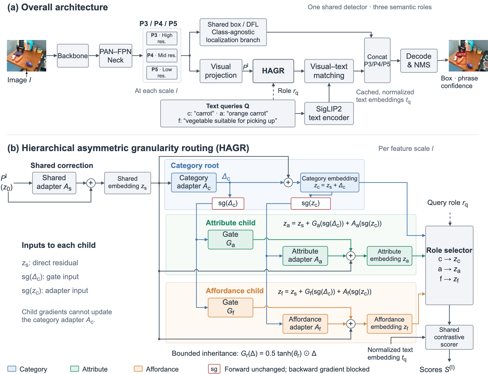

# HAGR-OVD

Code and models for **HAGR-OVD: Hierarchical Asymmetric Granularity Routing for Fine-Grained Open-Vocabulary Detection in Robot Manipulation Scenes**. Manuscript prepared for the *Chinese Journal of Mechanical Engineering*.

HAGR-OVD answers category, attribute, and affordance queries with one YOLO-World-S detector. Category forms the semantic root; attribute and affordance routes inherit bounded category context. Directional stop-gradient, role-balanced partial-label supervision, and attribute retention stabilize joint training. All roles share localization. Optical-flow augmentation supplies additional training views while inference remains single-frame.

<p align="center"></p>

## Downloads

| Artifact | Download | Contents |
|---|---|---|
| BridgeVLA-OVD annotations | [Google Drive: dataset](https://drive.google.com/drive/folders/1BwpUmOj40AldusK3svLvUcy2ysHq36S6?usp=drive_link) | Three annotation directories, README, SHA-256 manifest |
| Models | [Google Drive: checkpoints](https://drive.google.com/drive/folders/1f_w0axOIlNhuViz624A_TMu-mVM1IlQK?usp=drive_link) | SigLIP2-aligned base, HAGR, HAGR with temporal augmentation |

Download the dataset folder contents into `data/` and model files into `checkpoints/`. Keep `release_manifest.json` beside the three annotation directories. If Google Drive splits a folder download into multiple ZIPs, extract all parts to the same destination.

```text
HAGR-OVD/
├── data/
│   ├── release_manifest.json
│   ├── bridge_grounding/
│   ├── bridge_grounding_tri_granular/
│   └── bridge_grounding_temporal_joint/
├── checkpoints/
│   ├── yolo_world_siglip2_aligned_s.pt
│   ├── hagr_ovd_s.pt
│   └── hagr_ovd_temporal_s.pt
├── tools/
├── ultralytics/
├── tests/
└── configs/paths.env.example
```

### Dataset contents

| Directory | Experiment | Files used |
|---|---|---|
| `bridge_grounding` | Single-role CLIP/SigLIP2 adaptation; fixed validation for every model | Six role-specific train/val grounding JSONs, episode split files, YOLO validation labels, ordered `*_det.yaml` vocabularies |
| `bridge_grounding_tri_granular` | HAGR and router ablations | Tri-granular training JSON, ordered training vocabulary, data YAML |
| `bridge_grounding_temporal_joint` | Final temporal-joint training | Selected neighboring-frame training JSON and combined data YAML |

The benchmark has 52,739 representative frames and 388,652 regions, with 47,465 training and 5,274 validation episodes. Validation vocabularies contain 836 category labels, 6,681 attribute phrases, and 7,287 affordance phrases. The temporal training set adds one selected neighbor from 47,119 training episodes, containing 346,796 regions. The episode-disjoint split and validation labels are fixed across experiments.

The release contains annotations only. Obtain pixels from [BridgeData V2](https://github.com/rail-berkeley/bridge_data_v2), preserving the original source-row/video ordering and frame indexing. Filenames encode these identifiers, for example `row000000_video0_frame1.jpg`. An arbitrarily reordered video directory cannot reconstruct the release mapping.

Reconstruct images at these locations:

```text
data/bridge_grounding/images/                           # representative training frames
data/bridge_grounding/yolo/category/images/val/         # fixed validation frames
data/bridge_grounding/yolo/attribute_phrase/images/val/  # same validation frames
data/bridge_grounding/yolo/affordance_phrase/images/val/ # same validation frames
data/bridge_temporal_propagated/images/train/            # selected temporal neighbors
```

The three validation image directories may link to one shared copy. `bridge_temporal_propagated/images/train/` holds reconstructed pixels; it is not a fourth annotation download. Raw Qwen responses, audit votes, propagation logs, and rejected candidates are excluded. Training reads the released targets directly and requires no VLM service or optical-flow rerun.

### Checkpoints and reported results

| Checkpoint | Purpose | Category AP | Attribute AP | Affordance AP | Macro AP |
|---|---|---:|---:|---:|---:|
| `yolo_world_siglip2_aligned_s.pt` | SigLIP2-aligned YOLO-World-S initialization | — | — | — | — |
| `hagr_ovd_s.pt` | HAGR without temporal augmentation | 12.579 | 14.103 | 10.788 | 12.490 |
| `hagr_ovd_temporal_s.pt` | HAGR with temporal augmentation | 12.819 | 14.128 | 10.921 | 12.622 |

AP denotes IoU 0.50:0.95 AP (%) on the fixed validation split. The aligned base precedes Bridge fine-tuning and has no HAGR router; its Bridge role AP is unspecified. Both HAGR checkpoints support all three roles. The final model also obtains 56.247 class-agnostic object AP and 63.180% joint semantic recall under the diagnostic protocol. Model hashes are provided in the downloaded `model_manifest.json`.

## Environment and setup

The reported detector environment used Ultralytics **8.4.41**, Python **3.13.9**, PyTorch **2.7.1+cu118**, and NVIDIA RTX 4090 **24 GB** GPUs. SigLIP2 alignment used four GPUs. The research scripts require Python 3.10 or newer. Install a matching PyTorch/torchvision pair for your Python, driver, and CUDA environment before installing the fork.

From the repository root:

```bash
python3 -m venv .venv
source .venv/bin/activate
python3 -m pip install --upgrade pip
# Install your CUDA-compatible torch and torchvision builds first.
python3 -m pip install -e ".[hagr]"
python3 -m pip install git+https://github.com/ultralytics/CLIP.git
cp configs/paths.env.example configs/paths.env
source configs/paths.env
```

SigLIP2 uses `google/siglip2-base-patch16-512`; make its pretrained assets available, or configure the compatible local encoder path stored in the checkpoint. The CLIP package remains an import dependency of the fork. The public training workflow needs no vLLM, audit API client, Arrow dataset, or video decoding package.

Verify the release before training:

```bash
python3 tools/verify_release.py --data-root "$DATA_ROOT"
# After reconstructing images:
python3 tools/verify_release.py --data-root "$DATA_ROOT" --check-images
```

The verifier checks every published SHA-256, disjoint episode membership, and original/temporal training correspondence. `--check-images` also checks training and validation image paths. Trainers validate the public manifest directly, without historical `summary_*.json` construction logs.

## Evaluate the released models

```bash
MODEL="$CHECKPOINT_ROOT/hagr_ovd_s.pt" \
EVAL_OUTPUT=runs/evaluation/hagr.json \
  bash tools/run_bridge_granularity_router.sh eval

MODEL="$CHECKPOINT_ROOT/hagr_ovd_temporal_s.pt" \
EVAL_OUTPUT=runs/evaluation/hagr_temporal.json \
  bash tools/run_bridge_temporal_joint.sh eval
```

The common evaluator reports precision, recall, AP50, AP, exact-phrase seen/unseen AP, macro AP, and worst-role AP. Preserve validation vocabulary order. Unseen means an exact phrase is absent from the training vocabulary, rather than proving that its underlying concept was never observed.

Custom-vocabulary inference:

```bash
python3 tools/infer_hagr.py \
  --model checkpoints/hagr_ovd_temporal_s.pt \
  --source /path/to/robot_scene.jpg \
  --role attribute --prompts "orange carrot" "red bowl" "metal spoon"
```

Select `category`, `attribute`, or `affordance` explicitly. Use separate calls for different roles because role selection chooses the semantic route.

## Training and paper experiments

All commands run from the repository root. `DEVICE`, `BATCH`, `EPOCHS`, `LR0`, and output paths can be overridden. Batch values are global across the selected GPUs. The published weights are the reference endpoints for the paper; changing initialization or settings can change results.

### 1. SigLIP2 alignment

The aligned checkpoint is supplied, so downstream users may skip this step. To retrain alignment, configure Objects365, Flickr30k, GQA, and LVIS paths in `ultralytics/cfg/datasets/yolo_world_siglip2.yaml`:

```bash
python3 tools/train_yolo_world_siglip2.py \
  --device 0,1,2,3 --batch 4 --epochs 100 \
  --name yolov8s_worldv2_siglip2_aligned
```

Objects365 supplies detection data; Flickr30k and GQA supply grounding data. LVIS is used for generic transfer validation. These upstream datasets are obtained separately from the Bridge download.

### 2. Single-role Bridge fine-tuning and encoder comparison

```bash
for role in category attribute affordance; do
  python3 tools/train_bridge_role.py \
    --model "$CHECKPOINT_ROOT/yolo_world_siglip2_aligned_s.pt" \
    --data-root "$DATA_ROOT" --role "$role" \
    --device 0,1,2,3 --batch 64 --epochs 100
done
```

The same entry point accepts an official CLIP-based YOLO-World checkpoint. Use identical data, seed, batch, schedule, and optimizer options for matched encoder comparisons. These defaults provide a public retraining recipe; exact historical single-role settings must be taken from that run's configuration.

Single-role or LVIS evaluation uses the preserved raw protocol:

```bash
python3 tools/test_bridge_custom.py \
  --model /path/to/role_best.pt \
  --data "$BASE_DATASET/bridge_qwen_attribute_phrase_det.yaml" \
  --device 0 --batch 4
```

Use the corresponding category/affordance YAML or an LVIS detection YAML as needed. The evaluator checks the encoder family and unchanged text features during validation.

### 3. HAGR and routing ablations

This stage trains only HAGR. Backbone, neck, original semantic projections, and the box/DFL branch remain frozen. Adapter/gate learning rate is `3e-4`, with a `0.1` multiplier on the shared semantic residual. Bottleneck width is 192; up to 48 phrases are sampled per object. Role-gain ratios are `1:1:1`, normalized by the loss; retention gain is 1.0. AdamW uses weight decay `1e-4` and one warm-up epoch.

Use the **same Bridge-adapted SigLIP2 initialization** for full and ablated routers. For public retraining, the attribute checkpoint produced above can be used:

```bash
BRIDGE_INIT="$PWD/runs/bridge_roles/siglip_bridge_attribute/weights/best.pt"
BASE_MODEL="$BRIDGE_INIT" VARIANT=full \
DEVICE=0,1,2,3 BATCH=64 EPOCHS=40 \
  bash tools/run_bridge_granularity_router.sh all
```

The paper's routers used a common historical Bridge-adapted warm start, outside the three-checkpoint download. Training from a newly fine-tuned attribute detector is supported but does not exactly replay that historical initialization. Use the released HAGR weights to reproduce the reported evaluation endpoint.

| `VARIANT` | Change | Paper experiment |
|---|---|---|
| `full` | Complete category-rooted router | HAGR |
| `flat` | `category_prior=0` | Symmetric joint router |
| `no_stop_gradient` | Child gradients can update the category root | Stop-gradient ablation |
| `no_retention` | Attribute-retention gain set to zero | Retention ablation |

```bash
for variant in flat no_stop_gradient no_retention; do
  BASE_MODEL="$BRIDGE_INIT" VARIANT="$variant" \
  DEVICE=0,1,2,3 BATCH=64 EPOCHS=40 \
    bash tools/run_bridge_granularity_router.sh all
done
```

`all` trains then evaluates; no annotation rebuild is needed. Full-router runs select checkpoints by category AP by default. Keep `SELECTION_ROLE` and all settings matched within comparisons.

### 4. Temporal-joint fine-tuning

The published temporal JSON combines one selected neighboring frame per eligible training episode with original training data, approximately 1:1. Start from the published HAGR checkpoint:

```bash
BASE_MODEL="$CHECKPOINT_ROOT/hagr_ovd_s.pt" \
DEVICE=0,1,2,3 BATCH=64 EPOCHS=50 \
  bash tools/run_bridge_temporal_joint.sh all
```

HAGR and the shared `cv2` box/DFL branch are trainable. Router learning rate is `1e-4`; box learning rate is `2.5e-5` (`BOX_LR_MULT=0.25`). Warm-up is 0.5 epoch. Backbone, neck, text encoder, and original visual/text projections stay frozen. Checkpoints are selected by attribute AP. The released JSON already contains the propagated boxes; no flow recomputation is needed.

Early-stopping patience is 15 epochs for routing and 6 for temporal training. `EPOCHS` is the maximum schedule length; override `PATIENCE` explicitly if changing this policy.

## Additional paper evidence

The retained diagnostics cover object localization, cross-granularity consistency, frequency strata, compute cost, and gate analysis. Flat/ablation weights are generated by the commands above.

```bash
# Localization, cross-role consistency, and long-tail strata for HAGR.
HAGR_MODEL="$CHECKPOINT_ROOT/hagr_ovd_s.pt" \
  bash tools/run_bridge_granularity_diagnostics.sh hagr

# Temporal model: use separate output/cache paths.
HAGR_MODEL="$CHECKPOINT_ROOT/hagr_ovd_temporal_s.pt" \
DIAG_DIR=runs/diagnostics_temporal \
  bash tools/run_bridge_granularity_diagnostics.sh hagr
```

Strata metadata is regenerated from the released training JSON: unseen (0 training episodes), rare (1–10), common (11–100), frequent (>100). Neighbors do not alter these frequencies, and primary AP retains every validation class. Class-agnostic AP assesses boxes while ignoring class identity; joint semantic recall requires correct category, attribute, and affordance labels for the same geometrically matched object.

For matched flat-versus-HAGR diagnostics, supply the full and flat checkpoints trained from the same initialization:

```bash
FLAT_MODEL=/path/to/matched_flat_best.pt \
HAGR_MODEL=/path/to/matched_full_best.pt \
  bash tools/run_bridge_granularity_diagnostics.sh all
```

Cached-vocabulary compute comparison:

```bash
BASE_MODEL="$CHECKPOINT_ROOT/yolo_world_siglip2_aligned_s.pt" \
FLAT_MODEL=/path/to/matched_flat_best.pt \
HAGR_MODEL="$CHECKPOINT_ROOT/hagr_ovd_s.pt" \
  bash tools/run_bridge_granularity_efficiency.sh
```

The benchmark uses FP16, batch 1, 640-pixel input, 100 warm-up and 500 measured forwards. Text encoding, image loading, preprocessing, and NMS are excluded. Its paired comparison requires a trained flat checkpoint.

Export Figure 4 inheritance gates:

```bash
MODEL="$CHECKPOINT_ROOT/hagr_ovd_s.pt" \
  bash tools/run_bridge_hagr_gate_export.sh
```

## Implementation map

| File | Responsibility |
|---|---|
| `ultralytics/nn/modules/granularity_router.py` | Bounded adapters, inheritance gates, role selection |
| `ultralytics/nn/modules/head.py` | Routed semantic scores and shared box/DFL outputs |
| `ultralytics/models/yolo/world/train_granularity_router.py` | Partial-label losses, retention, trainable parameter groups |
| `tools/train_yolo_world_siglip2.py` | Generic SigLIP2 alignment |
| `tools/train_bridge_role.py` | Single-role CLIP/SigLIP2 adaptation |
| `tools/run_bridge_granularity_router.sh` | HAGR/flat/ablation training and evaluation |
| `tools/run_bridge_temporal_joint.sh` | Temporal-joint training and evaluation |
| `tools/eval_bridge_tri_granular.py` | Fixed three-role AP and seen/unseen evaluation |
| `tools/release_data.py`, `tools/verify_release.py` | Artifact and split validation |

Historical annotation/audit, packaging, temporal preprocessing, and abandoned research scripts have been removed from `tools/`. Core Ultralytics modules required to load published checkpoints remain included.

## Checks

```bash
python3 -m unittest discover -s tests -p test_release_data.py -v
python3 -m unittest discover -s tests -p test_public_launchers.py -v
python3 tests/test_bridge_granularity_diagnostics.py
python3 tests/test_bridge_granularity_router.py
```

The first two suites check release integrity/leakage rejection and shell argument forwarding without loading model weights. Diagnostic metric tests require NumPy; router tensor tests require the installed PyTorch/HAGR environment. Actual checkpoint evaluation should be performed on the GPU server with reconstructed images.

## License and citation

This research fork includes the Ultralytics AGPL-3.0 license; see [LICENSE](LICENSE) and [NOTICE.md](NOTICE.md). Follow upstream terms for BridgeData V2, YOLO-World, and SigLIP2 assets. Cite those works and the HAGR-OVD manuscript when using the release. The final bibliographic record will be added after publication.

The annotations are pseudo-labels and can contain errors. Reported results evaluate fine-grained perception; detector AP alone does not establish robot task success.
